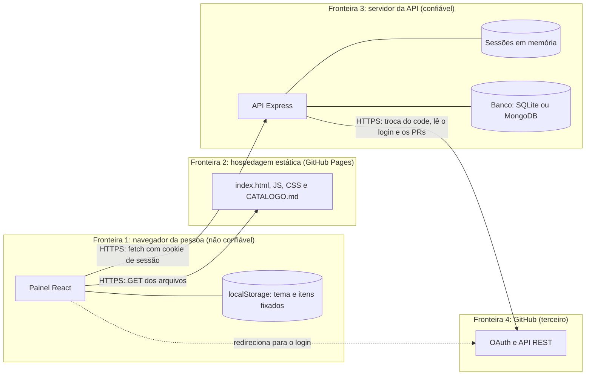

# Modelagem de ameaças do painel (STRIDE)

Quais ameaças o Painel de Formação e a API enfrentam, o que as mitiga e qual item ou issue cuida de cada uma. Item T10.6 do catálogo. Data: 10/11/2026. Revise este documento a cada rota nova na API (o modelo de PR lembra).

STRIDE é uma lista de seis tipos de ameaça: **S**poofing (fingir ser outra pessoa), **T**ampering (alterar dados), **R**epudiation (negar o que fez), **I**nformation disclosure (vazar informação), **D**enial of service (derrubar o serviço) e **E**levation of privilege (ganhar um poder que não tinha).

## Fluxo de dados e fronteiras de confiança

Cada seta que cruza uma fronteira é um ponto de ataque: o que chega do navegador e do GitHub é validado na API (`zod`), e nada que vem de fora entra numa consulta como texto.

## Ameaças e mitigações

| # | Tipo | Ameaça | Mitigação | Item ou issue |
|---|---|---|---|---|
| 1 | S | Alguém entra como outra pessoa forjando o retorno do login | `state` aleatório em cookie, comparado em tempo constante | T5.13 (feito) |
| 2 | S | Roubo ou falsificação do cookie de sessão | cookie `HttpOnly`, `Secure`, `SameSite=Lax`; id aleatório de 32 bytes; assinatura HMAC | T5.13, T10.8 (#135), T10.9 (#136) |
| 3 | T | Site de fora faz o navegador da pessoa registrar uma conclusão (CSRF) | `SameSite=Lax`, CORS só para o painel e checagem da origem nas rotas que mudam dados | T10.3 (feito), T10.8 (#135) |
| 4 | T | Injeção de SQL pelos filtros e parâmetros | consultas parametrizadas; entrada validada com `zod` | T6.6 (feito), T10.7 (#134) |
| 5 | T | Script injetado no título de um item aparece no painel (XSS) | o React escapa o texto; nenhum `innerHTML` no painel; CSP na API | T10.7 (#134) |
| 6 | T | Pessoa sem papel de mantenedor altera conclusões | papel checado no servidor (401 e 403) | T5.14 (feito) |
| 7 | T | Dependência maliciosa ou com falha conhecida | `npm audit` no CI, Dependabot, varredura da imagem | T10.2, T9.6, T9.13 (#130) |
| 8 | R | Alguém nega ter feito um pedido que mudou dados | log estruturado com id do pedido, rota, status e hora | T5.10 (feito) |
| 9 | I | Segredo (token, senha) no código | só variáveis de ambiente; `scripts/segredos.mjs` no CI | T10.1 (feito), #246 |
| 10 | I | Pilha de erro mostra caminhos e mensagens internas | middleware central com mensagem fixa no 500 | T10.14 (feito) |
| 11 | I | Tráfego lido no caminho (HTTP sem TLS) | só HTTPS, com HSTS | T10.10 (#137) |
| 12 | I | Dado pessoal guardado sem motivo | inventário e decisão por escrito; log sem dado pessoal | T10.5, T5.10 |
| 13 | D | Excesso de pedidos derruba a API | limite por endereço (429), corpo até 10 KB, tempos limite | T5.5, T10.14 (feito) |
| 14 | D | Falha ou limite da API do GitHub derruba a API | tempo limite e resposta 502 ou 503 sem cair | T5.5 (feito) |
| 15 | E | Falha no código dá acesso indevido | análise estática (CodeQL) e varredura dinâmica (ZAP) | T10.11 (#138), T10.12 (#139) |
| 16 | E | Workflow do CI com permissão demais | `permissions: contents: read` por padrão; escrita só no job que publica | T9.10 (#127) |

## Riscos aceitos

| Risco | Por que aceitamos | Até quando |
|---|---|---|
| A `main` não tem proteção: um push direto entra sem CI | decisão do responsável em 10/11/2026 (#38) | até ele decidir proteger (T9.2) |
| Sessões em memória: reiniciar a API desloga todo mundo | a API tem uma instância só; não há dado perdido, só a sessão | até haver mais de uma instância |
| O limite de pedidos é por endereço e em memória | atrás de proxy, vários usuários dividem o mesmo endereço; é um projeto de estudo com pouco tráfego | até a API ser publicada com tráfego real |
| O site estático no GitHub Pages não deixa configurar cabeçalhos (CSP, HSTS do painel) | o Pages já serve só HTTPS; o painel não tem formulário que envie dados | enquanto o painel estiver no Pages |
| O catálogo e quem fez cada item são públicos | é o propósito do painel; o login e o PR já são públicos no GitHub | permanente (ver `docs/dados-pessoais.md`) |

## Quando revisar

- A cada rota nova ou mudança de rota na API.
- A cada dado novo guardado (inclusive no `localStorage`).
- A cada serviço externo novo (hospedagem, banco, login).
