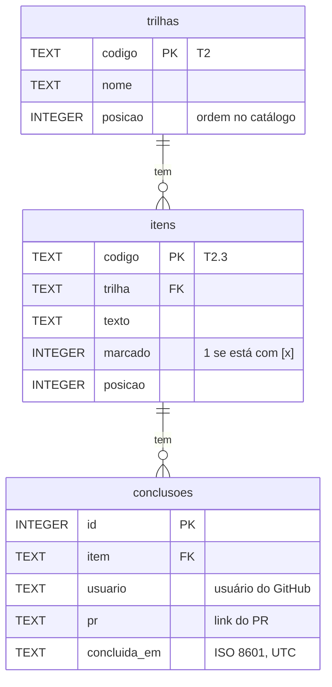

# Banco de dados do painel

No estudo, o banco é um arquivo SQLite aberto com o `node:sqlite` do próprio Node (22.13+), sem dependência nativa para compilar. As tabelas nascem das migrações em [`api/migracoes/`](../api/migracoes/). O `CATALOGO.md` continua sendo a fonte das trilhas e dos itens: o banco guarda uma cópia deles para as chaves estrangeiras e as consultas, e guarda o que só ele tem, as conclusões.

## Tabelas (T6.1)



| Tabela | Chave primária | Chaves estrangeiras | Índices |
|---|---|---|---|
| `trilhas` | `codigo` | — | — |
| `itens` | `codigo` | `trilha` → `trilhas.codigo` | `idx_itens_trilha (trilha, posicao)`: itens de uma trilha, na ordem |
| `conclusoes` | `id` | `item` → `itens.codigo` | `UNIQUE (item, usuario)`: uma conclusão por pessoa e item, e a busca por item; `idx_conclusoes_usuario (usuario)`: a busca por pessoa |

- As chaves estrangeiras usam `ON DELETE RESTRICT`: um item com conclusão não some do banco.
- O SQLite vem com as chaves estrangeiras desligadas; `api/src/banco/conexao.mjs` liga (`PRAGMA foreign_keys = ON`) em toda conexão.
- O índice da restrição `UNIQUE (item, usuario)` começa por `item`, então já atende `WHERE item = ?`. Um índice só de `item` seria repetido.

## Migrações (T6.3)

- Cada arquivo `api/migracoes/NNN_nome.sql` é uma versão. Elas rodam em ordem, uma vez só, cada uma numa transação.
- A tabela `schema_migracoes` guarda a versão, o arquivo e a hora. Rodar de novo não faz nada.
- Migração que falha é desfeita inteira e não fica registrada.
- Migração aplicada **não se edita**: mudança no banco vira um arquivo novo.
- Versão faltando, repetida ou nome fora do padrão param tudo antes de aplicar.

## Dados de teste

`npm run semear` cria o banco, aplica as migrações, leva o catálogo e grava conclusões de 12 pessoas fictícias (`pessoa-ficticia-01` a `-12`), com links de um repositório de exemplo (`github.com/exemplo/painel-de-formacao`) e datas espalhadas por 6 semanas. A semente é fixa: os dados saem sempre iguais. Nenhum dado pessoal real.

```bash
cd api
npm run migrar                 # aplica as migrações em dados/painel.db (ou em CAMINHO_DO_BANCO)
npm run semear                 # migra, leva o catálogo e grava os dados fictícios
```

O arquivo do banco (`api/dados/`) não vai para o Git.
