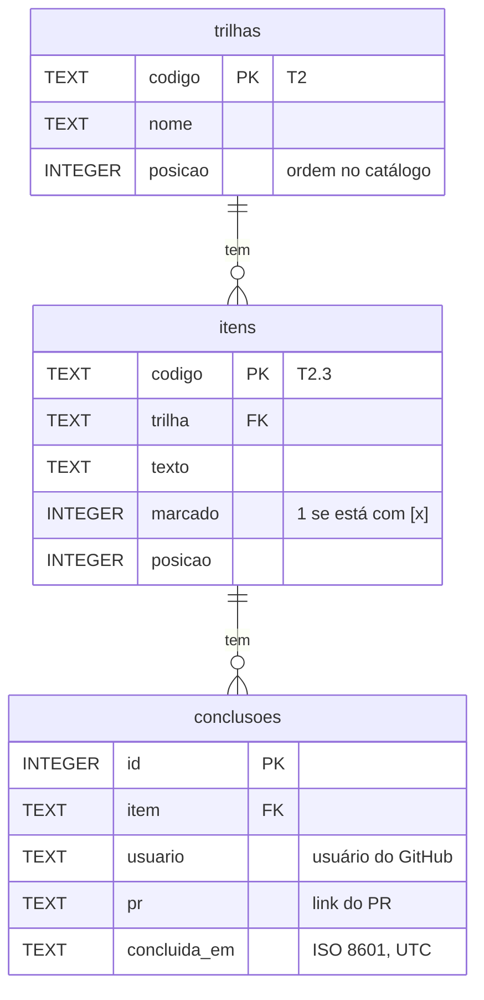

# Banco de dados do painel

No estudo, o banco é um arquivo SQLite aberto com o `node:sqlite` do próprio Node (22.13+), sem dependência nativa para compilar. As tabelas nascem das migrações em [`api/migracoes/`](../api/migracoes/). O `CATALOGO.md` continua sendo a fonte das trilhas e dos itens: o banco guarda uma cópia deles para as chaves estrangeiras e as consultas, e guarda o que só ele tem, as conclusões.

## Tabelas (T6.1)



| Tabela | Chave primária | Chaves estrangeiras | Índices |
|---|---|---|---|
| `trilhas` | `codigo` | — | — |
| `itens` | `codigo` | `trilha` → `trilhas.codigo` | `idx_itens_trilha (trilha, posicao)`: itens de uma trilha, na ordem |
| `conclusoes` | `id` | `item` → `itens.codigo` | `UNIQUE (item, usuario)`: uma conclusão por pessoa e item, e a busca por item; `idx_conclusoes_usuario (usuario)`: a busca por pessoa |

- As chaves estrangeiras usam `ON DELETE RESTRICT`: um item com conclusão não some do banco.
- O SQLite vem com as chaves estrangeiras desligadas; `api/src/banco/conexao.mjs` liga (`PRAGMA foreign_keys = ON`) em toda conexão.
- O índice da restrição `UNIQUE (item, usuario)` começa por `item`, então já atende `WHERE item = ?`. Um índice só de `item` seria repetido.

## Migrações (T6.3)

- Cada arquivo `api/migracoes/NNN_nome.sql` é uma versão. Elas rodam em ordem, uma vez só, cada uma numa transação.
- A tabela `schema_migracoes` guarda a versão, o arquivo e a hora. Rodar de novo não faz nada.
- Migração que falha é desfeita inteira e não fica registrada.
- Migração aplicada **não se edita**: mudança no banco vira um arquivo novo.
- Versão faltando, repetida ou nome fora do padrão param tudo antes de aplicar.

## Dados de teste

`npm run semear` cria o banco, aplica as migrações, leva o catálogo e grava conclusões de 12 pessoas fictícias (`pessoa-ficticia-01` a `-12`), com links de um repositório de exemplo (`github.com/exemplo/painel-de-formacao`) e datas espalhadas por 6 semanas. A semente é fixa: os dados saem sempre iguais. Nenhum dado pessoal real.

```bash
cd api
npm run migrar                 # aplica as migrações em dados/painel.db (ou em CAMINHO_DO_BANCO)
npm run semear                 # migra, leva o catálogo e grava os dados fictícios
```

O arquivo do banco (`api/dados/`) não vai para o Git.

## Repositório SQLite (T6.6)

`api/src/repositorios/sqlite.mjs` segue a mesma interface do repositório em memória (`contrato.mjs`). A mesma bateria de testes (`api/test/repositorio.test.mjs`) roda contra os dois.

| Operação | Função | SQL |
|---|---|---|
| Gravar | `registrarConclusao` | `INSERT ... ON CONFLICT (item, usuario) DO NOTHING RETURNING ...` |
| Ler | `listarConclusoes`, `obterConclusao` | `SELECT ... WHERE (:item IS NULL OR item = :item) ...` |
| Atualizar | `atualizarConclusao` | `UPDATE conclusoes SET pr = ? WHERE id = ? RETURNING ...` |
| Apagar | `apagarConclusao` | `DELETE FROM conclusoes WHERE id = ?` |

- Toda consulta é preparada uma vez e recebe os valores por parâmetro (`?` ou `:nome`). Nenhum texto que vem de fora entra na string SQL; um teste lê o arquivo e falha se achar uma interpolação. Outro teste manda `x' OR '1'='1` como filtro e confere que nada vaza.
- O filtro opcional usa `:item IS NULL OR item = :item`, em vez de montar o `WHERE` com texto.

### Apagar de verdade ou marcar como apagado

**Decisão: apagar de verdade (`DELETE`).** Motivos:
- A conclusão liga uma pessoa a um PR. Se a pessoa pedir para sair, a LGPD pede que o dado suma; uma coluna `apagada_em` deixaria o dado no banco.
- O histórico já existe fora do banco: o PR fica no GitHub. O banco não precisa guardar uma auditoria própria.
- Sem a coluna, toda consulta fica mais simples: não há `WHERE apagada_em IS NULL` para esquecer.

Se um dia precisarmos de auditoria (quem apagou e quando), o caminho é uma tabela de eventos à parte, não uma marca na linha.

## Conclusão sem duplicar (T6.5)

A restrição `UNIQUE (item, usuario)` é a garantia. O código não faz "existe? se não, grava": entre a pergunta e a gravação, outro pedido pode gravar primeiro. A gravação usa `INSERT ... ON CONFLICT DO NOTHING RETURNING`: se a linha nasceu, a rota responde 201; se já existia, lê a que existia e responde 200.

O teste `api/test/concorrencia.test.mjs` sobe dois apps (como dois servidores), cada um com a sua conexão no mesmo arquivo, e dispara 20 pedidos iguais ao mesmo tempo: um 201, dezenove 200 e uma linha só no banco.

## Restrições (T6.7)

A migração `002_restricoes.sql` põe no banco as regras que a API já valida, para que nenhum caminho (um script, outro serviço, um `INSERT` à mão) grave dado ruim. O SQLite não acrescenta `CHECK` numa tabela que existe: cada tabela é recriada com as regras, os dados são copiados e a antiga sai. A 001 continua como estava.

| Tabela | Restrição | O que recusa |
|---|---|---|
| `trilhas` | `CHECK` no `codigo` | Código fora de `Tn` |
| `itens` | `CHECK` no `codigo` | Código fora de `Tn.m`, ou que não começa pelo código da trilha |
| `itens` | `CHECK` em `marcado`, `posicao` e `texto` | `marcado` fora de 0 e 1, posição zero ou negativa, texto vazio |
| `itens` | Chave estrangeira `trilha` | Item de trilha que não existe |
| `conclusoes` | Chave estrangeira `item` | Conclusão de item que não existe; apagar item que tem conclusão |
| `conclusoes` | `NOT NULL` | Conclusão sem item, usuário, PR ou data |
| `conclusoes` | `UNIQUE (item, usuario)` | A mesma pessoa no mesmo item duas vezes |
| `conclusoes` | `CHECK` em `usuario`, `pr` e `concluida_em` | Usuário fora das regras do GitHub, link que não é de PR, data fora do ISO 8601 em UTC |

O `CHECK` da data usa `IS` e não `=`: com uma data inválida, `strftime` devolve `NULL`, e `x = NULL` não é falso, é `NULL`, que o `CHECK` deixa passar.

O migrador guarda a soma (sha256) de cada migração aplicada. Se um arquivo já aplicado mudar, ele para com "foi editada depois de aplicada: crie uma migração nova".

Os testes estão em `api/test/restricoes.test.mjs`: um por restrição, mais um que confere que os dados de antes sobrevivem à 002.

## Repositório MongoDB (T6.12 e T6.13)

Para comparar na prática com o relacional (ADR 004), `api/src/repositorios/mongo.mjs` segue a mesma interface. `REPOSITORIO=mongo` com `MONGO_URL` (e `MONGO_BANCO`, padrão `painel`) faz a API usá-lo.

| Coleção | Documento | Índices |
|---|---|---|
| `trilhas` | `{ _id: "T2", nome, posicao }` | `_id` |
| `itens` | `{ _id: "T2.3", trilha, texto, marcado, posicao }` | `_id`, `{ trilha, posicao }` |
| `conclusoes` | `{ _id: 12, item, usuario, pr, concluidaEm }` | `_id`, único `{ item, usuario }`, `{ usuario }` |
| `contadores` | `{ _id: "conclusoes", valor }` (o próximo id) | `_id` |

- O índice único `{ item, usuario }` faz o papel da `UNIQUE` (T6.5): a gravação repetida recebe o erro 11000 e devolve a conclusão que existia. Um teste dispara 10 gravações iguais ao mesmo tempo e confere uma só.
- Não há chave estrangeira: quem garante que o item existe é a API (T5.2). É a diferença que a ADR 004 aponta.
- As baterias de testes do repositório, do progresso, do ranking e dos concluintes rodam contra memória, SQLite e MongoDB. No CI, o job `api` sobe o serviço `mongo:7` e falha se algum teste for pulado; no Windows sem Docker, os testes do MongoDB aparecem como pulados, com o motivo.

### Progresso por trilha com agregação (T6.13)

O pipeline `PIPELINE_DO_PROGRESSO` parte de `trilhas`:

1. `$sort` pela posição e `$lookup` dos itens da trilha (pelo índice `{ trilha, posicao }`);
2. `$unwind` com `preserveNullAndEmptyArrays` (trilha sem itens continua, como o `LEFT JOIN` da view);
3. `$lookup` de uma conclusão do item, com `$match` em `$expr` sobre `item` (pelo índice `{ item, usuario }`) e `$limit: 1`;
4. `$group` por trilha: total de itens e feitos (marcado no catálogo ou com conclusão);
5. `$project` do percentual, arredondado para baixo.

Um teste semeia os mesmos dados fictícios no SQLite e no MongoDB e confere que o resultado do pipeline é igual ao da view `v_progresso_trilha` nas 12 trilhas; as outras consultas (pessoas, concluintes, ranking com `$setWindowFields` e `$rank`, semanas com `$dateTrunc`) também batem. O `explain('executionStats')` do pipeline mostra os índices `item_1_usuario_1` e `trilha_1_posicao_1` em uso.
